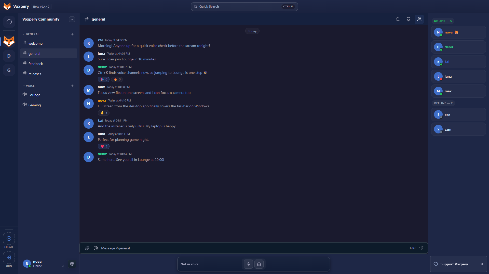

<h1 align="center">
  <br />
  Voxpery
</h1>

<div align="center">

**Open-source chat, voice, and screen sharing for communities that want control.**

Use Voxpery in your browser, download the desktop app, or host the same stack yourself.

[](LICENSE)
[](https://github.com/emircanagac/voxpery/actions/workflows/ci.yml)

[Use in browser](https://voxpery.com/register) · [Download desktop](https://github.com/emircanagac/voxpery/releases/latest) · [Self-host](docs/DEPLOYMENT.md)



</div>

## Why Voxpery?

- **Chat together:** Text channels, DMs, voice channels, screen sharing, and moderation in one place.
- **Choose where it runs:** Join the hosted service or deploy the full stack with Docker Compose.
- **Light on your computer:** The desktop apps for Windows, macOS, and Linux are built on Tauri and use the system webview; the Windows installer is about 8 MB.
- **Keep it inspectable:** The web app, server, and desktop client are developed in the open under the AGPL-3.0 license.
- **Own your account data:** Export your data or delete your account; self-hosters control their own deployment.

Voxpery is still growing. Larger platforms have broader integrations and more mature enterprise tooling. See the [comparison with other chat platforms](https://voxpery.com/compare) for a closer look.

## Get started

**Use the hosted app:** [Create an account](https://voxpery.com/register) and start chatting in your browser. No server setup is required.

**Self-host:** Start the web app, server, LiveKit, PostgreSQL, and Redis with Docker Compose:

```bash
git clone https://github.com/emircanagac/voxpery.git
cd voxpery
cp .env.example .env
# Replace every CHANGE_ME value in .env (openssl rand -hex 32) before starting.
docker compose config >/dev/null
docker compose up -d --build
```

Open [localhost:5173](http://localhost:5173). For production setup, TLS, backups, and optional integrations, follow the [deployment guide](docs/DEPLOYMENT.md).

## Build and contribute

Voxpery uses Rust and Axum, React and TypeScript, PostgreSQL, Redis, LiveKit, and Tauri. The [contributing guide](docs/CONTRIBUTING.md) covers local development and pull requests; the [architecture guide](docs/ARCHITECTURE.md) explains how the pieces fit together.

Have an idea or found a bug? [Open an issue](https://github.com/emircanagac/voxpery/issues) or [join the discussion](https://github.com/emircanagac/voxpery/discussions). See the [roadmap](docs/ROADMAP.md) for current priorities.

## Policies

[Security reporting](SECURITY.md) · [Privacy Notice](docs/PRIVACY_NOTICE.md) · [KVKK Notice](docs/KVKK_AYDINLATMA_METNI.md) · [Terms of Service](docs/TERMS_OF_SERVICE.md) · [Code of Conduct](docs/CODE_OF_CONDUCT.md)

Self-host operators should publish their own legal notices; the [privacy template](docs/SELF_HOST_PRIVACY_TEMPLATE.md) is a starting point.

Voxpery is licensed under [AGPL-3.0](LICENSE).
