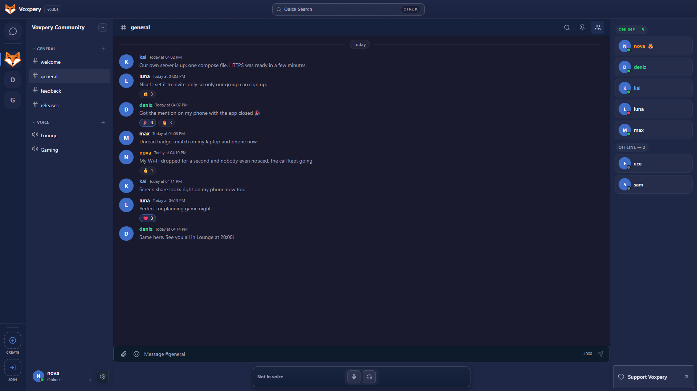

<h1 align="center">
  <br />
  Voxpery
</h1>

<div align="center">

**Voice, chat and screen sharing for your friend group, on a server you own.**

Open-source and self-hosted, with web and desktop apps for Windows, macOS and Linux: a Discord alternative for friend groups, gaming groups and small communities that you run yourself.

[](LICENSE)
[](https://github.com/emircanagac/voxpery/actions/workflows/ci.yml)
[](https://github.com/sponsors/emircanagac)

[Try it on voxpery.com](https://voxpery.com/register) · [Self-host](#self-host) · [Download desktop](https://github.com/emircanagac/voxpery/releases/latest)



</div>

## Why Voxpery?

- **Voice, screen sharing and chat in one app:** Voice channels, screen sharing, text channels and direct messages, with moderation, in a layout that feels familiar.
- **Cheap to run:** The whole stack uses about 350 MB of memory with five people in voice calls; voxpery.com runs on a server that costs about €8 a month. See [how it was measured](docs/RESOURCE_USAGE.md).
- **One command to install:** A setup script writes the configuration with fresh secrets, and a bundled proxy gets HTTPS certificates for a public server.
- **Light on your computer:** The desktop apps are built on Tauri, with the system webview on Windows and macOS and Chromium on Linux; the Windows installer is about 8 MB.
- **Private by default:** No telemetry, and notifications name the sender and the conversation, never the message. Export your data or delete your account at any time.
- **Open source:** The web app, server and desktop client are developed in the open under the AGPL-3.0 license.

Voxpery is still growing. Larger platforms have broader integrations and more mature enterprise tooling. See the [comparison with other chat platforms](https://voxpery.com/compare) for a closer look.

## Get started

**Try it first:** [Create an account on voxpery.com](https://voxpery.com/register) and use it in your browser with your friends, with nothing to set up.

**Desktop app:** Download it for Windows, macOS, or Linux (.deb, .rpm, Flatpak) from the [latest release](https://github.com/emircanagac/voxpery/releases/latest).

### Self-host

You need a 64-bit Linux server (x86-64 or arm64) with Docker and Docker Compose. 1 GB of RAM is a comfortable minimum; the optional ClamAV file scanner needs about 1 GB more and runs only on x86-64. Details are in the [deployment guide](docs/DEPLOYMENT.md).

Start the web app, server, LiveKit, PostgreSQL, and Redis with Docker Compose:

```bash
git clone https://github.com/emircanagac/voxpery.git
cd voxpery
./scripts/ops/init_env.sh   # writes .env with fresh random secrets
docker compose up -d --build
```

This builds the server and web images on your machine, which takes a few minutes. Then open [localhost:5173](http://localhost:5173). For a public server, the same script and a bundled HTTPS proxy set everything up from three domain names and run the published release images: see [Public server with HTTPS](docs/DEPLOYMENT.md#public-server-with-https). Backups and optional integrations are in the [deployment guide](docs/DEPLOYMENT.md).

## Build and contribute

Voxpery uses Rust and Axum, React and TypeScript, PostgreSQL, Redis, LiveKit, and Tauri. The [contributing guide](docs/CONTRIBUTING.md) covers local development and pull requests; the [architecture guide](docs/ARCHITECTURE.md) explains how the pieces fit together.

Have an idea or found a bug? [Open an issue](https://github.com/emircanagac/voxpery/issues) or [join the discussion](https://github.com/emircanagac/voxpery/discussions). See the [roadmap](docs/ROADMAP.md) for current priorities.

## Policies

[Security reporting](SECURITY.md) · [Privacy Notice](docs/PRIVACY_NOTICE.md) · [KVKK Notice](docs/KVKK_AYDINLATMA_METNI.md) · [Terms of Service](docs/TERMS_OF_SERVICE.md) · [Code of Conduct](docs/CODE_OF_CONDUCT.md)

Self-host operators should publish their own legal notices; the [privacy template](docs/SELF_HOST_PRIVACY_TEMPLATE.md) is a starting point.

Voxpery is licensed under [AGPL-3.0](LICENSE).
